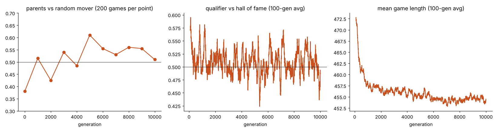

# Phase 3: parameter-efficient evolution (low-rank MLP)

## Setup
- **Network:** a 20-layer MLP, 128 wide, tanh. Same inputs as phase 2c: own, opponent and empty points, legal moves, and a progress value.
- **Low-rank weights:** every weight matrix is a pure low-rank product **W = A·B**, with A of size out×32 and B of size 32×in. Nothing is full rank.
  - The genome holds only A, B and the biases: **216,266 weights**. The 10-layer full-rank MLP of phase 2c had 363,882.
  - Starting weights: each entry of A and B has spread (gain²/(fan_in·r))^¼, so W = A·B has the usual variance-preserving spread.
  - Checked on generation 0: the hidden signal stays at a spread of about 0.6 through all 20 layers, with under 2% of units saturated.
- **Mutation:** Gaussian noise on A, B and the biases, with σ = 0.03 times each block's starting spread. No crossover.
- **Selection:** as in phase 2d.
  - 32 genomes play a knockout bracket.
  - The top 4 each play 2 qualifier games against the hall of fame of past champions.
  - The 4 best reproduce (elitism).
- **Run:**
  - 10,000 generations, seed 0, all 4 cores, about 1 s per generation (~3 h in total).
  - No benchmark during the run. The random mover was used only afterwards, as a yardstick.
  - Container restarts interrupted the run twice. It resumed from `state.pt` each time, so the result is the same as an uninterrupted run.
- **Files:** `runs/p3_r32_s0/` holds the config, the history and the final 4 parents (`gen10000.pt`).
  - Command: `python -m goevo.phase3 --out work/p3_r32_s0` (add `--resume` to continue, `--rank 8` for another rank).

## Results



```
phase 3 (work/p3_r32_s0), final generation 10000. Win rate of the final parents (all pairings x both colours)
vs own gen 0           0.781 ± 0.073  (n=32)
vs own gen 1000        0.562 ± 0.088  (n=32)
vs own gen 5000        0.500 ± 0.088  (n=32)
vs 2d conv champions  0.219 ± 0.073  (n=32)
vs random mover       0.500 ± 0.025  (n=400)
vs 2c MLP champions  0.688 ± 0.082  (n=32)
parents vs random mover by generation (50 games per parent)
gen     0  0.380
gen  1000  0.515
gen  2000  0.425
gen  3000  0.540
gen  4000  0.485
gen  5000  0.610
gen  6000  0.555
gen  7000  0.530
gen  8000  0.560
gen  9000  0.555
gen 10000  0.510
```

All head-to-head games are deterministic, with all pairings played with both colours. The ± values are binomial standard errors.

## Interpretation
- **Faster than the full-rank MLP:** the low-rank network reaches the strength of the phase 2c MLP quickly.
  - It wins about 50% against the random mover by generation 1000. Phase 2c needed about 2000 generations with twice the population, so about 4× fewer games.
  - The final champions beat the phase 2c MLP champions **69%** of the time.
  - This matches your experiment: mutating the A, B factors pays off faster than mutating the full W.
- **But it levels off early:**
  - The final parents beat their generation-1000 ancestors only 56% of the time, and their generation-5000 ancestors 50% of the time.
  - The random-mover yardstick stays flat at 0.5–0.6 from about generation 1000.
  - The qualifier against past champions hovers at 0.5.
  - So most of the 10,000 generations added little.
- **The conv network of phase 2d is much stronger:** it wins 78% against these champions. Its liberty inputs and weight sharing across the board matter more than the number of weights.
- **Likely limits:** the inputs (no liberty information), and noisy selection (one game per bracket match), not the rank.
- **Possible next steps:**
  - Give the low-rank MLP the conv inputs (liberty planes).
  - Compare rank 8 and rank 32.
  - Larger σ, or decreasing σ over time.
  - More games per selection step.
