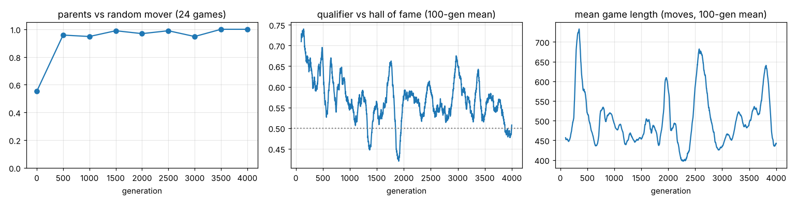

# Phase 4: residual CNN with normalization

## Setup
- **Network (`--arch resnet`), 20,482 weights:**
  - A 3×3 conv stem takes the 11 input planes of phase 2d to 16 channels:
    - own / opponent / empty points and legal moves;
    - own and opponent groups with 1, 2 or ≥3 liberties;
    - a constant plane that marks the board edge.
  - 4 pre-activation residual blocks: norm → tanh → 3×3 conv → norm → tanh → 3×3 conv, added to the block's input.
  - A final norm and tanh, then the phase 2d heads: a 1×1 conv gives one logit per point, and a linear layer on the globally averaged features gives the pass logit.
  - **Norm:** LayerNorm over (C, H, W) with a per-channel gain and bias (GroupNorm with 1 group). There is no batch, because positions are evaluated one at a time.
  - **Starting weights:**
    - gains 1, biases 0;
    - conv weights with the usual variance-preserving spread;
    - the second conv of each block starts at 0.1× (close to an identity block).
  - **Generation-0 checks:** the numpy forward pass matches torch within 7e-7, the block outputs have a spread of about 0.87, and 1% of units are saturated.
- **Mutation:** Gaussian noise with σ = 0.03 times each block's mutation scale; the scale is 0.1 for the norm gains and biases. No crossover.
- **Selection:** as in phase 2d.
  - 32 genomes play a knockout bracket.
  - The top 4 each play 2 qualifier games against the hall of fame (up to 50 past champions).
  - Fitness = rounds won + 1.5 × qualifier win rate; the 4 best reproduce, with elitism.
- **Run:**
  - 4000 generations, seed 0, 4 cores.
  - 8.3 h of compute, about 156k games.
  - It ran in tracked segments of about 110 minutes, resuming from `state.pt` each time, so the container could not restart mid-run. The result is the same as an uninterrupted run.
  - The random-mover check every 500 generations is only a yardstick; it plays no part in selection.
- **Files:** `runs/p4_s0/` holds the config, the history and the final 4 parents (`gen4000.pt`).
  - Command: `python -m goevo.phase4 --out work/p4_s0` (add `--resume` to continue).

## Results



```
phase 4 (work/p4_s0), final generation 4000. Win rate of the final parents (all pairings x both colours)
vs own gen 0              0.938 ± 0.043  (n=32)
vs own gen 1000           0.625 ± 0.086  (n=32)
vs own gen 2000           0.938 ± 0.043  (n=32)
vs own gen 3000           0.812 ± 0.069  (n=32)
vs 2d conv champions      0.812 ± 0.069  (n=32)
vs 3 low-rank champions   1.000 ± 0.000  (n=32)
vs random mover           1.000 ± 0.000  (n=400)
```

Head-to-head games are deterministic (masked argmax), with all pairings played with both colours. The ± values are binomial standard errors. The random-mover figure comes from 100 games per parent.

## Interpretation
- **Strongest so far.** The final parents:
  - beat the random mover in **400 of 400** games (phase 2d: 0.885, phase 3: 0.50);
  - beat the phase 2d conv champions **81%** of the time;
  - won every game against the phase 3 low-rank champions.
- **The norms and residual connections are what changed.** The network has fewer weights than the plain 10-layer conv net of phase 2d (20.5k vs 22.5k). It reached 0.96 against the random mover by generation 500, which phase 2d never did.
- **Still improving, but noisily:**
  - The final parents beat their generation-2000 and generation-3000 ancestors 94% and 81% of the time.
  - Against generation 1000 they win only 62%. With 32 deterministic games this is a large error bar, and some match-ups are non-transitive.
  - The qualifier rate against the hall of fame slowly drops toward 0.5 (about 0.62 in the first 1000 generations, 0.55 in the last). That is expected when the hall fills with stronger past champions.
  - Game length swings between about 400 and 730 moves. These phases show the population's playing style changing.
- **The random mover no longer measures progress.** Head-to-head games against fixed opponents are the yardstick from here on.
- **Next:** phase 5, a PPO self-play baseline with this same network on the same CPU budget (branch `claude/phase5-rl`).
