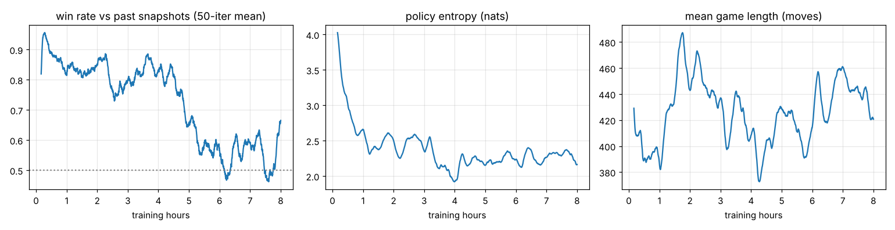

# Phase 5: PPO self-play baseline

## Setup
- **Same network as phase 4:** the residual CNN with GroupNorm(1), 16 channels and 4 blocks, 20,482 weights.
  - The weights are kept in genome order, so a trained policy is an ordinary genome. It is evaluated with exactly the same `Player` (masked argmax) and the same rules as the evolved players.
  - A small **value head** (295 weights: global average → 16 tanh → 1 tanh) is used only during training. The playing network has no extra weights.
  - It starts from the same random initialization as an evolution genome.
- **Training:** PPO, all pytorch, CPU only, 4 cores.
  - Each iteration plays 32 games, sampling moves at temperature 1, in 4 worker processes.
  - Opponents: in half the games the current policy plays itself, and both sides are training data. Otherwise the opponent is a random snapshot from a pool of past policies (one added every 10 iterations, up to 50 kept), and only the learner's side is trained on.
  - Reward: +1 / −1 at the end of the game.
  - Credit assignment: GAE with γ = 1, λ = 0.95.
  - Updates: 3 epochs with minibatch 1024 and Adam at lr 3e-4. Clipped objective with clip 0.2, value loss weight 0.5, entropy bonus 0.01, gradient clipping at 0.5, and a KL early stop at 0.03.
- **Budget:** 8.0 h of wall-clock time on 4 cores, matching phase 4 (8.3 h).
  - That came to **2,270 iterations and 72.6k games**. Phase 4 used about 156k games, so PPO spends roughly two thirds of its time on updates.
  - It ran in tracked segments with `--resume`. One container restart at 6.8 h cost 3 iterations.
- **Files:** `runs/p5_s0/` holds the config, the history and `final.pt` (the last 4 policies). The hourly policies were kept in `work/p5_s0/h*.pt` and not committed.
  - Command: `python -m goevo.ppo --out work/p5_s0 --hours 8` (add `--resume` to continue).
  - Evaluation: `python -m goevo.eval_phase5`.

## Results



```
phase 5 PPO (work/p5_s0): 2270 iterations, 72640 games, 8.00 h. Win rate of the last 4 policies (all pairings x both colours)
vs own hour 0               1.000 ± 0.000  (n=8)
vs own hour 1               1.000 ± 0.000  (n=8)
vs own hour 2               1.000 ± 0.000  (n=8)
vs own hour 4               1.000 ± 0.000  (n=8)
vs own hour 6               0.750 ± 0.153  (n=8)
vs own hour 7               0.375 ± 0.171  (n=8)
vs phase 4 evolved parents  1.000 ± 0.000  (n=32)
vs 2d conv champions        1.000 ± 0.000  (n=32)
vs 3 low-rank champions     1.000 ± 0.000  (n=32)
vs random mover             1.000 ± 0.000  (n=400)

PPO hourly policy vs the phase 4 evolved parents (final, gen 4000)
hour 0  it     0  games      0  vs phase-4 parents 0.125 (n=8)
hour 1  it   298  games   9536  vs phase-4 parents 1.000 (n=8)
hour 2  it   558  games  17856  vs phase-4 parents 1.000 (n=8)
...
hour 7  it  1982  games  63424  vs phase-4 parents 1.000 (n=8)
```

Games are deterministic (masked argmax), with every pairing played with both colours, so n is small. The ± values are binomial standard errors.

## Interpretation
- **PPO wins clearly on the same network and the same CPU budget.**
  - After **1 hour** (about 9.5k games) the PPO policy already beat the final phase 4 evolved parents, which took 8.3 h and about 156k games. It won 8 of 8.
  - The final PPO policies won every game against the phase 4, phase 2d and phase 3 champions, and every one of 400 games against the random mover.
- **Why: learning signal per game.**
  - Evolution gets about 1 bit per game (who won) and spends it on choosing which genome survives.
  - PPO gets a gradient for each of its roughly 200 moves per game, and the value head tells it which moves changed the expected outcome.
  - With 20k weights, gradient information beats random mutation plus selection by a wide margin.
- **PPO itself is still improving, but slowly.** The final policies beat hours 0–4 every time, hour 6 75% of the time and hour 7 only 38%. With 8 games per comparison this is noisy, but it suggests progress is levelling off at this network size.
- **Caveats:**
  - **Small samples:** deterministic play gives few distinct games per pairing (8 or 32).
  - **Deterministic opponents:** the evolved players always pick their top move, so a trained policy may partly be exploiting that predictability.
  - **Tuning:** PPO used standard settings without tuning, and so did evolution (σ = 0.03, 32 genomes).
- **Possible next steps:**
  - Compare at a matched number of **games** as well as matched time: evolution's first 10k games is about 250 generations.
  - Evaluate with sampled moves to get more distinct games.
  - Combine the two methods, for example by starting evolution from the PPO policy, or evolving PPO settings.
  - A bigger network for PPO, where gradients should scale better than mutation.
