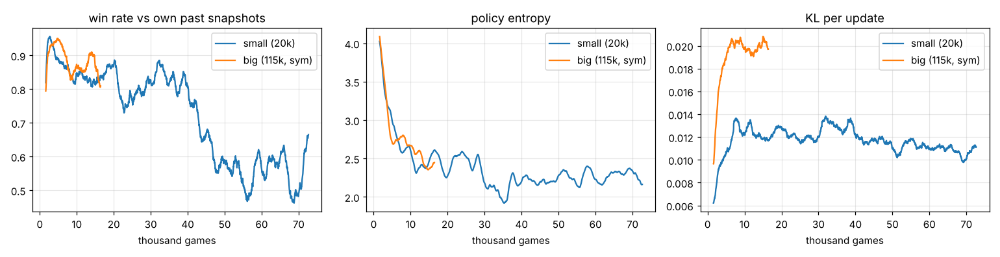

# Phase 5b: PPO with a bigger network and board-symmetry augmentation

## Setup
- **Network:** the same residual design as phases 4 and 5, but **32 channels and 6 blocks: 115,074 policy weights**, 5.6× the small network.
  - Value head: 289 weights, used only for training.
  - Same random initialization scheme as before.
- **Augmentation (`--sym`):** every move is decided on a randomly rotated or mirrored board (one of 8) and stored in that orientation. PPO stays exact, and all orientations are trained on.
- **PPO and self-play:** identical to phase 5.
  - 32 games per iteration; half against the current policy, half against a pool of past snapshots.
  - Reward ±1, GAE with λ = 0.95.
  - 3 epochs, minibatch 1024, learning rate 3e-4, clip 0.2, entropy bonus 0.01.
- **Budget:** 8.0 h on 4 CPU cores, the same as phases 4 and 5. That came to **513 iterations and 16.4k games**; the small network got 2,270 iterations and 72.6k games.
  - An update of the big network costs about 5× more, at about 45 s per iteration versus about 8 s.
- **Files:** `runs/p5b_s0/` holds the config, the history, `final.pt` (the last 4 policies) and `full.pt` (policy plus value head; load with `goevo.ppo.load_full`).
  - Command: `python -m goevo.ppo --out work/p5b_s0 --channels 32 --blocks 6 --sym --hours 8 --bench-every 25` (add `--resume` to continue).

## Results



```
phase 5b PPO (work/p5b_s0): 513 iterations, 16416 games, 8.01 h. Win rate of the last 4 policies (all pairings x both colours)
vs own hour 0               1.000 ± 0.000  (n=8)
vs own hour 2               1.000 ± 0.000  (n=8)
vs own hour 4               0.875 ± 0.117  (n=8)
vs own hour 6               0.750 ± 0.153  (n=8)
vs own hour 7               0.500 ± 0.177  (n=8)
vs phase 5 PPO (small net)  0.000 ± 0.000  (n=32)
vs phase 4 evolved parents  1.000 ± 0.000  (n=32)
vs 2d conv champions        1.000 ± 0.000  (n=32)
vs 3 low-rank champions     1.000 ± 0.000  (n=32)

equal games: big final (16416 games) vs the small PPO hourly snapshots
vs small PPO hour 1 (  9536 games): 0.875 (n=8)
vs small PPO hour 2 ( 17856 games): 0.125 (n=8)
vs small PPO hour 3 ( 26496 games): 0.250 (n=8)
vs small PPO hour 4 ( 35392 games): 0.000 (n=8)
vs small PPO hour 7 ( 63424 games): 0.000 (n=8)
```

Play is deterministic (masked argmax), with every pairing played with both colours, so n is small. Random-mover games were skipped; PPO players all beat it.

## Interpretation
- **At the same CPU time, the bigger network loses.** It lost all 32 games to the small-network PPO, although it beat every evolved player.
- **It is also slower per game.** Its final policies, after 16.4k games, beat the small network's 9.5k-game snapshot 7 of 8 times. But they won only 1 of 8 against its 17.9k-game snapshot, and 2 of 8 against the 26.5k-game one. So the small network, with random rotations off, learned more from each game here.
- **Likely reasons:**
  - **Random rotations:** the board is shown in a random orientation every move, so each pattern has to be learned in all 8 orientations. That helps generalization later but slows early learning.
  - **Same settings as the small network:** at the same learning rate, the big network's updates moved the policy about twice as far (KL 0.020 vs 0.012). That is noisier, and 3 epochs per batch may be too many.
  - **More weights need more data,** and 513 updates is few.
- **Still improving at the end:** the final policies beat the 4-hour and 6-hour snapshots 7 and 6 times out of 8. Based on the small network's progress, it would need roughly **20–30 h** (about 50–70k games) to reach the small network's final strength, and longer to surpass it.
- **Possible next steps:**
  - Run 5b longer with `--resume`.
  - Lower the learning rate (1e-4) and/or use 2 epochs per update.
  - Turn `--sym` off for the first hours.
  - A middle size (24 channels, 5 blocks).
