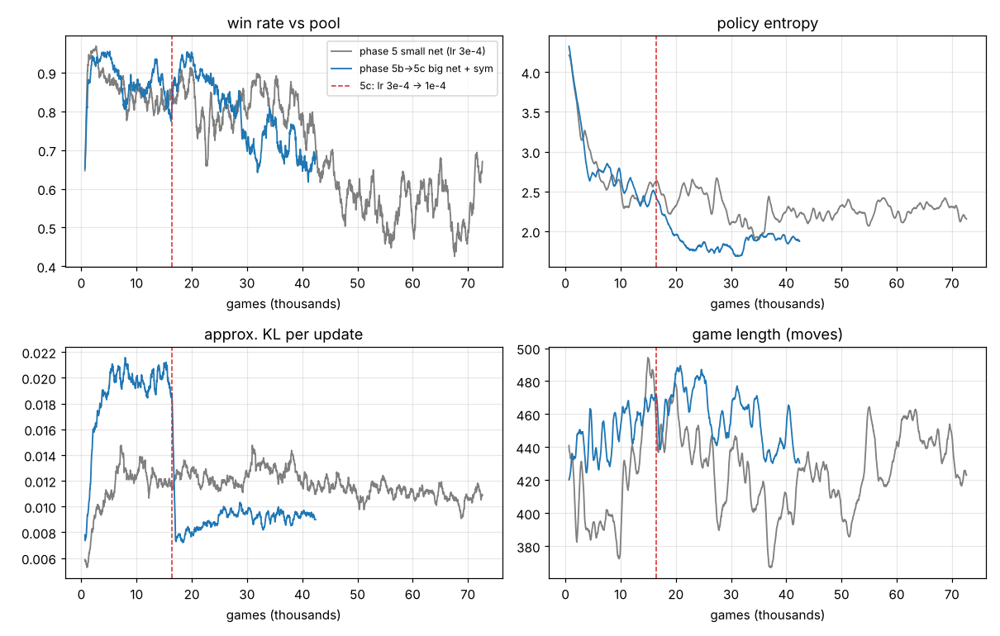

# Phase 5c: the bigger PPO network, continued at a lower learning rate

## Setup
- **Starting point:** phase 5b's last checkpoint (iteration 513, 8.01 h, 16.4k games), resumed with `--resume`.
- **One change: learning rate 3e-4 → 1e-4.** Everything else is as in phase 5b:
  - the same network (32 channels, 6 blocks, 115,074 policy weights);
  - random board rotations and mirrors (`--sym`);
  - the same PPO settings, self-play and opponent pool.
- **Budget:** 12 more hours, 20.0 h in total on 4 CPU cores. That came to **1,325 iterations and 42.4k games** in total, 26.0k of them in phase 5c.
  - It ran in tracked segments. One container restart at 17.5 h cost 3 iterations.
- **Files:** `runs/p5c_s0/` holds the config, the history (all 20 h, from phase 5b's start), `final.pt` (the last 4 policies) and `full.pt` (policy plus value head; load with `goevo.ppo.load_full`).
  - Command: `python -m goevo.ppo --out work/p5c_s0 --channels 32 --blocks 6 --sym --hours 20 --lr 1e-4 --resume`, on a copy of `work/p5b_s0`.
  - With `--resume`, the `--lr` given on the command line now replaces the learning rate saved in the checkpoint.

## Results



The curves are plotted against games played. Grey is the small network (phase 5); blue is the big network, phase 5b up to the red line and phase 5c after it.

```
phase 5c PPO (work/p5c_s0): 1325 iterations, 42400 games, 20.01 h. Win rate of the last 4 policies (all pairings x both colours)
vs own hour 4               1.000 ± 0.000  (n=8)
vs own hour 7               1.000 ± 0.000  (n=8)
vs own hour 8 (= 5b final)  1.000 ± 0.000  (n=8)
vs own hour 11              0.750 ± 0.153  (n=8)
vs own hour 14              0.875 ± 0.117  (n=8)
vs own hour 17              0.500 ± 0.177  (n=8)
vs own hour 19              0.500 ± 0.177  (n=8)
vs phase 5 PPO (small net)  0.688 ± 0.082  (n=32)
vs phase 4 evolved parents  1.000 ± 0.000  (n=32)
vs 2d conv champions        1.000 ± 0.000  (n=32)
vs 3 low-rank champions     1.000 ± 0.000  (n=32)

equal games: 5c final (42400 games) vs the small PPO hourly snapshots
vs small PPO hour 3 ( 26496 games): 1.000 (n=8)
vs small PPO hour 4 ( 35392 games): 0.875 (n=8)
vs small PPO hour 5 ( 44384 games): 0.625 (n=8)
vs small PPO hour 6 ( 54016 games): 0.750 (n=8)
vs small PPO hour 7 ( 63424 games): 0.625 (n=8)

hourly 5c snapshot vs the small PPO final (n=8 each)
hour 11 (22.6k games) 0.375   hour 13 (26.7k) 0.375   hour 14 (28.9k) 0.125
hour 15 (31.0k)       0.000   hour 16 (33.1k) 0.125   hour 17 (35.3k) 0.500
```

Play is deterministic (masked argmax), with every pairing played with both colours, so n is small. Hours 0–7 are phase 5b; hour 8 is where phase 5c started.

## Interpretation
- **The big network now beats the small one.** Its final policies won **22 of 32 (69%)** against the small network's final policies. Phase 5b, after 8 h, lost all 32.
- **The lower learning rate helped:**
  - The policy change per update (KL) dropped from about 0.020 to 0.008–0.010, below the small network's 0.012.
  - The final policies beat the 5b final (hour 8) 8 of 8.
  - Entropy fell faster: from about 2.5 to about 1.9 within 10k games, below the small network's 2.2. The policy became more decided.
- **Per game, it is now about even with the small network, maybe a little ahead.** With 42.4k games it beats the small network's 35k-game snapshot 7 of 8 times. It also wins 5, 6 and 5 of 8 against the 44k-, 54k- and 63k-game snapshots, which had more games than it did. In phase 5b it was about 1.25× *less* efficient per game; the lower learning rate made up the difference.
- **Per hour, it costs 2.5× more:** 20 h for the big network versus 8 h for the small one.
- **Progress is slowing:** the final policies only split evenly with the 17 h and 19 h snapshots. The hourly snapshots against the small final also swing a lot (0 to 4 of 8). With deterministic play and 8 games per comparison, much of that is noise.
- **Possible next steps:**
  - A larger evaluation with sampled moves, to get tighter numbers.
  - Another lr drop (3e-5), or more games per iteration.
  - GPU training, which would mostly speed up the update step (about 80% of each iteration).
