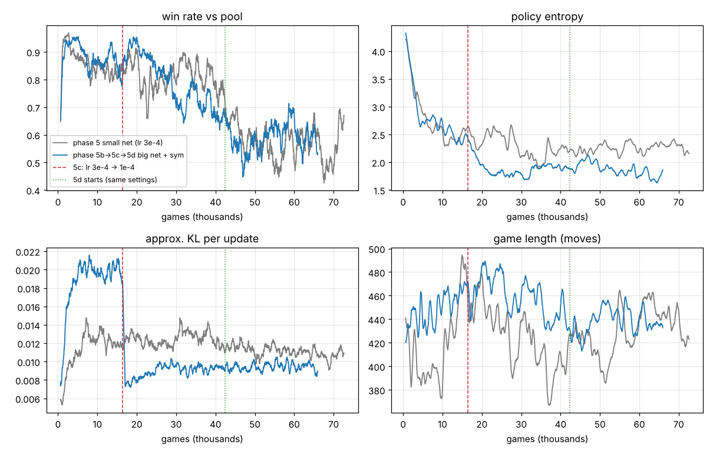

# Phase 5d: 12 more hours for the bigger PPO network

## Setup
- **Continuation of phase 5c, nothing changed:**
  - resumed from its last checkpoint (iteration 1325, 20.0 h, 42.4k games);
  - the same network (32 channels, 6 blocks, 115,074 policy weights);
  - random board rotations and mirrors on;
  - learning rate 1e-4, and all other PPO settings the same.
- **Budget:** 12 more hours, 32.0 h in total on 4 CPU cores. That came to **2,061 iterations and 66.0k games** in total, 23.6k of them in phase 5d.
- **Files:** `runs/p5d_s0/` holds the config, the history (all 32 h, from phase 5b's start), `final.pt` (the last 4 policies) and `full.pt` (policy plus value head; load with `goevo.ppo.load_full`).
  - Command: `python -m goevo.ppo --out work/p5d_s0 --channels 32 --blocks 6 --sym --hours 32 --lr 1e-4 --resume`, on a copy of `work/p5c_s0`.

## Results



```
phase 5d PPO (work/p5d_s0): 2061 iterations, 65952 games, 32.00 h. Win rate of the last 4 policies (all pairings x both colours)
vs own hour 8 (= 5b final)   1.000 ± 0.000  (n=8)
vs own hour 20 (= 5c final)  0.625 ± 0.171  (n=8)
vs own hour 23               0.500 ± 0.177  (n=8)
vs own hour 26               0.375 ± 0.171  (n=8)
vs own hour 29               0.375 ± 0.171  (n=8)
vs own hour 31               0.625 ± 0.171  (n=8)
vs phase 5 PPO (small net)   0.594 ± 0.087  (n=32)
vs phase 4 evolved parents   1.000 ± 0.000  (n=32)
vs 2d conv champions         1.000 ± 0.000  (n=32)
vs 3 low-rank champions      1.000 ± 0.000  (n=32)
5d final vs 5c final (all 4 x 4 policies)  0.656 ± 0.084  (n=32)

equal games: 5d final (65952 games) vs the small PPO hourly snapshots
vs small PPO hour 5 ( 44384 games): 0.875 (n=8)
vs small PPO hour 6 ( 54016 games): 0.750 (n=8)
vs small PPO hour 7 ( 63424 games): 0.750 (n=8)

hourly 5d snapshot vs the small PPO final (n=8 each)
hour 23 (49.2k games) 0.625   hour 25 (53.1k) 0.750   hour 27 (56.8k) 0.750   hour 29 (60.5k) 0.500
```

Play is deterministic (masked argmax), with every pairing played with both colours, so n is small.

## Interpretation
- **Small gain, mostly a plateau.**
  - The 5d final beats the 5c final 21 of 32 (66%).
  - Against its own 23–31 h snapshots it is no better than even: 0.375–0.625, n=8 each.
- **Against the small network:**
  - 19 of 32 (59%) against its final policies. Phase 5c scored 22 of 32; within the error bars, that is the same.
  - At about equal games (63k vs 66k), it wins 6 of 8.
  - So the big network is now a little stronger than the small one at a similar number of games, but not by much. At this learning rate it seems to have levelled off at about the small network's level.
- **The curves agree:**
  - The win rate against the pool sits around 0.55–0.65, like the small network's late phase.
  - KL is steady at about 0.009.
  - Entropy drifts down slowly (about 1.9 → 1.7).
- **Cost:** 32 h for the big network versus 8 h for the small one, for a small edge.
- **Possible next steps:**
  - A further learning rate drop (3e-5).
  - More games per iteration, to make the gradient less noisy.
  - A larger evaluation with sampled moves, since the deterministic n=8–32 comparisons cannot resolve differences this small.
  - GPU training, if bigger networks are the goal.
