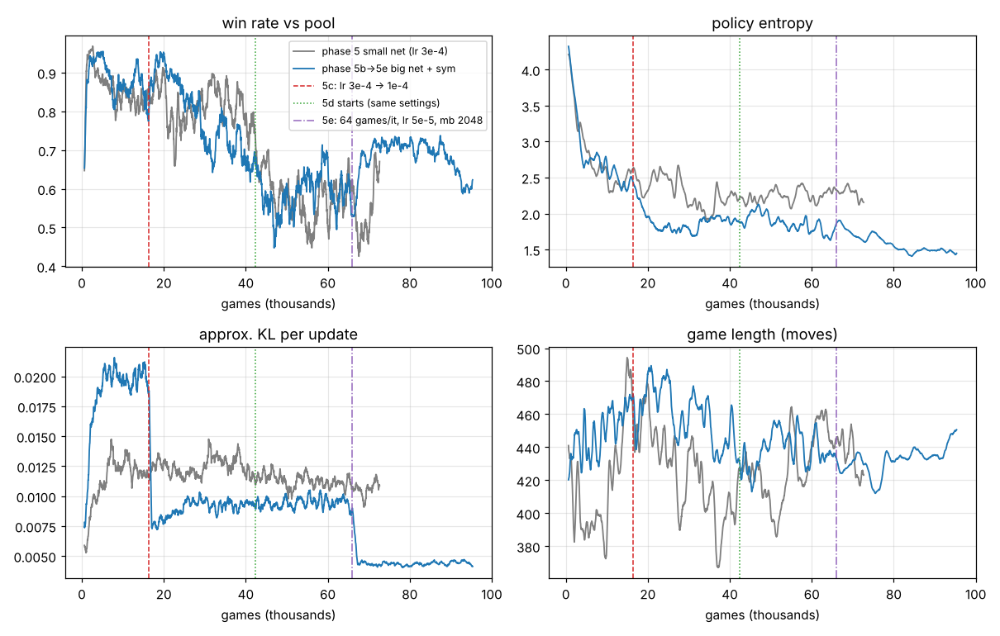

# Phase 5e: the bigger PPO network with bigger batches and a lower learning rate

## Setup
- **Starting point:** phase 5d's last checkpoint (iteration 2061, 32.0 h, 66.0k games), resumed with `--resume`.
- **Three changes:**
  - 64 games per iteration instead of 32;
  - learning rate 1e-4 → 5e-5;
  - minibatch 1024 → 2048.
  - Everything else is as in phase 5d: the same network (32 channels, 6 blocks, 115,074 policy weights), random board rotations and mirrors, and the same PPO settings, self-play and opponent pool.
- **Budget:** 16 more hours, 48.0 h in total on 4 CPU cores. That came to **2,520 iterations and 95.3k games** in total, 29.4k of them in phase 5e.
  - It ran in tracked segments. One container restart at about 37 h cost a few iterations.
- **Files:** `runs/p5e_s0/` holds the history (all 48 h, from phase 5b's start), `final.pt` (the last 4 policies) and `full.pt` (policy plus value head; load with `goevo.ppo.load_full`).
  - `config.json` there is **stale**: it is not rewritten on resume and still shows the phase 5b settings. The settings actually used are the ones above.
  - Command: `python -m goevo.ppo --out work/p5e_s0 --channels 32 --blocks 6 --sym --hours 48 --games 64 --lr 5e-5 --minibatch 2048 --resume`, on a copy of `work/p5d_s0`.

## Results



The curves are plotted against games played. Grey is the small network (phase 5); blue is the big network. The purple line marks the start of phase 5e.

```
phase 5e PPO (work/p5e_s0): 2520 iterations, 95328 games, 48.01 h. Win rate of the last 4 policies (all pairings x both colours)
vs own hour 20 (= 5c final)  0.750 ± 0.153  (n=8)
vs own hour 32 (= 5d final)  0.875 ± 0.117  (n=8)
vs own hour 35               0.750 ± 0.153  (n=8)
vs own hour 38               0.750 ± 0.153  (n=8)
vs own hour 41               0.500 ± 0.177  (n=8)
vs own hour 44               0.375 ± 0.171  (n=8)
vs own hour 47               0.375 ± 0.171  (n=8)
vs phase 5 PPO (small net)   0.594 ± 0.087  (n=32)
5e final vs 5d final (all 4 x 4 policies)  0.562 ± 0.088  (n=32)

equal games: 5e final (95328 games) vs the small PPO hourly snapshots
vs small PPO hour 6 ( 54016 games): 0.500 (n=8)
vs small PPO hour 7 ( 63424 games): 0.875 (n=8)

hourly 5e snapshot vs the small PPO final (n=8 each)
hour 35 (71.3k games) 0.875   hour 37 (75.2k) 0.625   hour 38 (77.3k) 0.875
hour 40 (80.9k)       0.375   hour 42 (84.7k) 0.500   hour 44 (88.3k) 0.500   hour 46 (91.9k) 0.625
```

Play is deterministic (masked argmax), with every pairing played with both colours, so n is small. The evolved players were not played this time; the earlier big-network phases beat all of them 32 of 32.

## Interpretation
- **Early gain, then a plateau again.**
  - The final policies beat the 5d final (hour 32) 7 of 8 and the 35–38 h snapshots 6 of 8.
  - Against the 41–47 h snapshots they are no better than even (0.375–0.5). Most of the gain came in the first 6 hours of phase 5e.
- **Against the small network, nothing changed:** 19 of 32 (59%), exactly as in phase 5d. All 4 final policies against all 4: 5e beats 5d only 18 of 32 (56%).
- **The training curves:**
  - KL dropped from about 0.009 to about 0.004 and stayed there: smaller, steadier updates, as intended.
  - Entropy fell faster than before: about 1.75 → 1.45. The policy got more decided.
  - The win rate against the pool rose to about 0.71 around 75–85k games, then eased to about 0.65. A rising pool win rate partly reflects a pool of weaker past selves, so it does not by itself show progress against outside players.
- **Bigger batches and a lower learning rate made training more stable, but did not get the big network past the small one.** After 95k games and 48 h, it is still only slightly ahead of a small network that trained for 8 h on 72.6k games.
- **Next:** phase 5f takes the small network back up, resuming it for 16 h with the same changes that helped the big network (lr 1e-4, random rotations and mirrors, 64 games per iteration, minibatch 2048). That shows whether the big network's extra size is buying anything.
