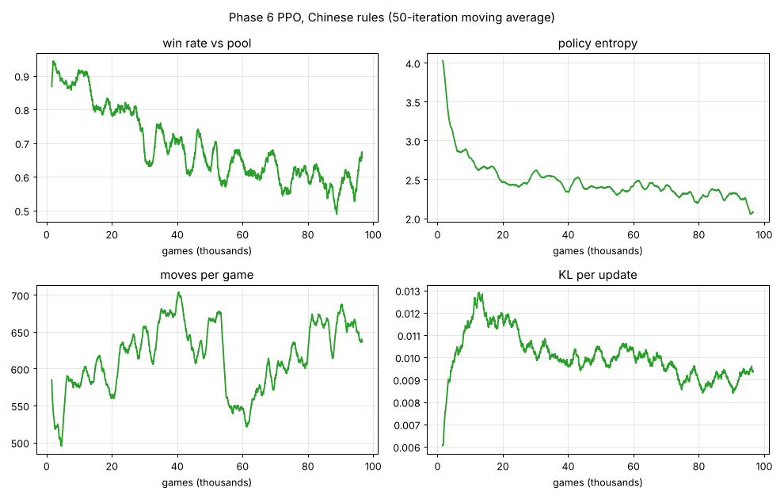

# Phase 6: PPO under Chinese rules

## Setup
- **Rules** (`goevo.match.CHINESE`, `--rules chinese`):
  - pass any time; two passes in a row end the game;
  - filling your own eye is allowed;
  - area scoring (stones plus surrounded empty points), komi 7.5;
  - simple ko; move cap 1083.
  - Phases 1–5 used forced passing instead: pass only when no other move is allowed, and never fill your own eye.
- **Network:** the small phase 5 network (16 channels, 4 blocks), with 2 extra input planes: "the opponent just passed" and "the player to move is Black". 20,770 policy weights.
  - Old checkpoints load unchanged; they have no extra planes.
- **Training:** from scratch, the same PPO paradigm as phase 5 (self-play half the time, otherwise a pool of past snapshots), with random board rotations and mirrors.
  - Budget: 16 h on 4 CPU cores, which came to **3,019 iterations and 96.6k games**.
  - Command: `python -m goevo.ppo --out work/p6_s0 --rules chinese --sym --hours 16 --bench-every 0`, run in segments with `--resume`.
  - Two container restarts, at 7.9 h and 12.0 h, each cost a few minutes.
- **Files:** `runs/p6_s0/` holds `config.json`, `history.jsonl`, `final.pt` (the last 4 policies) and `full.pt` (policy plus value head).

## Results



```
phase 6 PPO (work/p6_s0): 3019 iterations, 96608 games, 16.00 h. Win rate of the last 4 policies (all pairings x both colours)
vs own hour 0               1.000  (n=8)
vs own hour 2               1.000  (n=8)
vs own hour 4               1.000  (n=8)
vs own hour 6               1.000  (n=8)
vs own hour 8               0.875  (n=8)
vs own hour 10              0.875  (n=8)
vs own hour 12              0.625  (n=8)
vs own hour 14              0.625  (n=8)
vs own hour 15              0.500  (n=8)

checks during training: one hourly snapshot vs the previous 4 (n=8)
h05 6/8   h07 5/8   h09 4/8   h11 6/8   h13 6/8   h15 4/8
```

Play is deterministic (masked argmax), with both colours, so n is small. Under the new rules, the phase 1–5 players are not comparable, so they were not played.

### How the final policies' games end (4 policies, 12 pairings each)
- **Deterministic (temperature 0):**
  - 3 of 12 games hit the 1083-move cap;
  - in 8 of 12, one side passed often (38–287 times) while the other kept playing;
  - in every game where only one side passed often, that side won.
- **Temperature 1, as in training:** 503–887 moves, 1–19 passes per side, no game hit the cap.
- Margins are often very large (100–330 points). Our guess: the losing side keeps playing into the opponent's area instead of passing, so its stones get captured. This was not checked.

## Interpretation
- **It learned steadily for about 10 h, then slowed down.** The final policies beat everything up to hour 10 at least 7 of 8, but only 5 of 8 against hours 12–14 and 4 of 8 against hour 15.
- **Game length did not fall** (about 600 moves on average, curve above). Games end by two passes, but only after a long stretch of filling; the networks have not learned to stop when the board is settled.
- **Entropy fell from about 4.0 to about 2.1**, more slowly than in phase 5. The win rate against the pool fell from about 0.9 to about 0.6, as the pool filled with stronger past selves.
- Whether the openings changed (the third-line question) was not measured.
