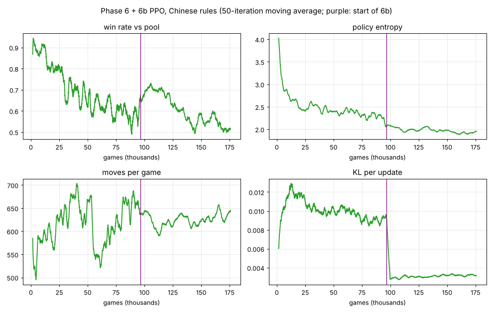

# Phase 6b: phase 6 continued at a lower learning rate, with bigger batches

## Setup
- **Starting point:** phase 6's last checkpoint (iteration 3019, 16.0 h, 96.6k games), resumed with `--resume`. Same network (16 channels, 4 blocks, 2 extra planes, 20,770 policy weights) and the same Chinese rules (`goevo.match.CHINESE`).
- **Three changes** (the 5e/5f settings):
  - learning rate 3e-4 → 1e-4;
  - 64 games per iteration instead of 32;
  - minibatch 1024 → 2048.
- **Budget:** 20 more hours, 36.0 h in total. That came to **4,256 iterations and 175.8k games**, 79.2k of them in phase 6b.
  - An iteration took about 60 s instead of about 21 s, so 6b played about 4k games an hour instead of about 6k.
- **Files:** `runs/p6b_s0/` holds the history (all 36 h, from phase 6's start), `final.pt` (the last 4 policies) and `full.pt` (policy plus value head).
  - `config.json` there is **stale**: it is not rewritten on resume and still shows the phase 6 settings. The settings actually used are the ones above.
  - Command: `python -m goevo.ppo --out work/p6b_s0 --rules chinese --sym --hours 36 --games 64 --lr 1e-4 --minibatch 2048 --bench-every 0 --resume`, on a copy of `work/p6_s0`.

## Results



The purple line marks the start of phase 6b.

```
phase 6b PPO (work/p6b_s0): 4256 iterations, 175776 games, 36.00 h. Win rate of the last 4 policies (all pairings x both colours)
vs own hour 8               0.875  (n=8)
vs own hour 12              0.625  (n=8)
vs own hour 16 (= phase 6 end)  0.750  (n=8)
vs own hour 20              0.875  (n=8)
vs own hour 24              0.750  (n=8)
vs own hour 28              0.750  (n=8)
vs own hour 32              0.500  (n=8)
vs own hour 34              0.625  (n=8)
vs own hour 35              0.375  (n=8)
vs phase 6 final (16 h), all 4 x 4 policies   0.781 ± 0.073  (n=32)

checks during training: one hourly snapshot vs the previous 4 (n=8)
h17 6/8   h19 5/8   h21 6/8   h23 4/8   h26 6/8   h28 4/8   h30 3/8   h32 5/8
```

Play is deterministic (masked argmax), with both colours, so n is small: single rows of n=8 are noisy (for example 5 of 8 against hour 12 but 7 of 8 against hour 20).

## Interpretation
- **6b is clearly stronger than phase 6:** its final policies beat the phase 6 final 25 of 32 (78%).
- **Most of the gain came by about 28 h.** Against snapshots from hour 28 or earlier it wins 6–7 of 8; against hours 32–35 it is about even (3–5 of 8). The hourly checks from 28 h on were 4, 3 and 5 of 8: a plateau again.
- **The training curves:**
  - KL fell from about 0.009 to about 0.003: smaller, steadier updates, as intended.
  - Entropy fell slowly, from about 2.2 to about 1.9.
  - Game length did not change (about 630 moves). The networks still have not learned to end games early.
- A direct match against the phase 5 players is not fair under these rules, since they never learned when to pass, so it was not played.
