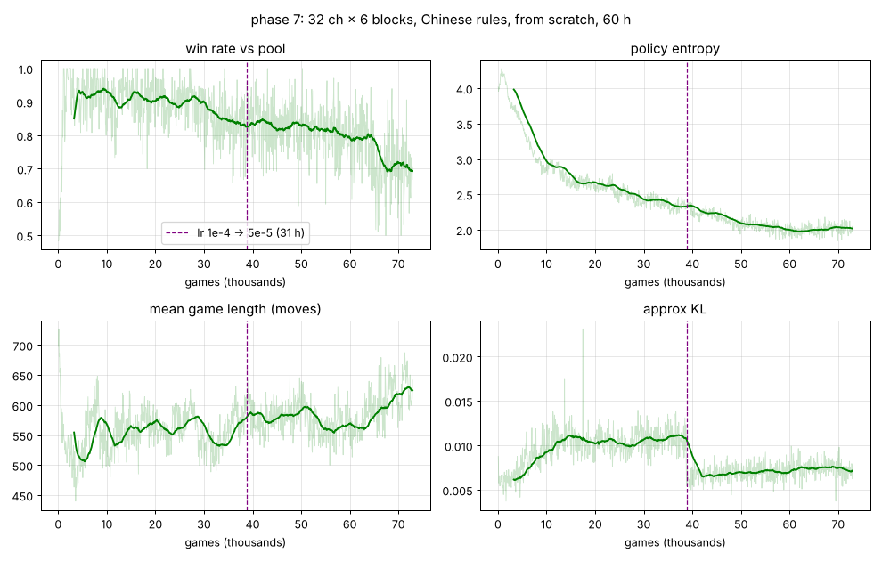

# Phase 7: the large network under Chinese rules, from scratch

## Setup
- **Network:** the phase 5b–5e size (32 channels, 6 blocks) plus phase 6's 2 extra input planes (opponent just passed; mover is Black). That is 115,650 policy weights, against 20,770 for phase 6/6b.
- **Rules:** Chinese (`goevo.match.CHINESE`), as in phase 6. Trained from scratch.
- **Training settings:** those of phase 6b: 64 games per iteration, minibatch 2048, `--sym`.
  - Learning rate 1e-4 for 0–31 h.
  - At 31 h the hourly checks had stalled at 2–4 of 8, so the run was resumed with lr 5e-5 for 31–60 h.
- **Budget:** planned at 40 h and raised to 60 h during the run. That came to **1,139 iterations and 72.9k games**.
  - An iteration took about 190 s (about 25 s of play and 150–200 s of update), so the run played only about 1.2k games an hour. Phase 6b played about 4k.
- **Files:** `runs/p7_s0/` holds `history.jsonl`, `final.pt` (the last 4 policies) and `full.pt` (policy plus value head).
  - `config.json` there is **stale**: it is not rewritten on resume and still shows `hours 40` and `lr 1e-4`.
  - `history.jsonl` lacks one row at each of the 37 resumes (iterations 30, 65, …, 1125). Those iterations were trained, but their row was not saved.
- **Command:** `python -m goevo.ppo --out work/p7_s0 --rules chinese --channels 32 --blocks 6 --sym --hours 60 --games 64 --lr 5e-5 --minibatch 2048 --bench-every 0 --resume` (with `--lr 1e-4` before 31 h), in segments of `timeout 6600`.

## Results



The purple line marks the learning-rate change at 31 h.

```
phase 7 PPO (work/p7_s0): 1139 iterations, 72896 games, 60.04 h. Win rate of the last 4 policies (all pairings x both colours)
vs own hour 8               1.000 ± 0.000  (n=8)
vs own hour 16              1.000 ± 0.000  (n=8)
vs own hour 24              1.000 ± 0.000  (n=8)
vs own hour 31              0.750 ± 0.153  (n=8)
vs own hour 40              0.750 ± 0.153  (n=8)
vs own hour 48              0.750 ± 0.153  (n=8)
vs own hour 56              0.750 ± 0.153  (n=8)
vs own hour 58              0.750 ± 0.153  (n=8)
vs own hour 59              0.500 ± 0.177  (n=8)
vs phase 6b final (36 h)    0.219 ± 0.073  (n=32)
```

**Checks during training:** one hourly snapshot vs the previous 4 snapshots (n=8), and vs the 6b final's 4 policies (n=8).

| Hour | vs previous 4 | vs 6b final |
|---|---|---|
| h05 | 7/8 | 0/8 |
| h10 | 7/8 | 0/8 |
| h17 | 8/8 | 0/8 |
| h22 | 7/8 | 0/8 |
| h24 | 2/8 | 0/8 |
| h27 | 3/8 | 0/8 |
| h29 | 3/8 | 0/8 |
| h31 | 4/8 | 1/8 |
| h34 | 8/8 | 1/8 |
| h36 | 4/8 | 1/8 |
| h39 | 7/8 | 0/8 |
| h41 | 6/8 | 1/8 |
| h43 | 4/8 | 1/8 |
| h45 | 2/8 | 2/8 |
| h47 | 3/8 | 1/8 |
| h49 | 5/8 | 2/8 |
| h51 | 4/8 | 0/8 |
| h53 | 4/8 | 1/8 |
| h55 | 7/8 | 0/8 |
| h57 | 4/8 | 1/8 |
| h59 | 3/8 | 0/8 |

Play is deterministic (masked argmax), with both colours, so n is small and single rows are noisy.

## Interpretation
- **Phase 7 is weaker than phase 6b:** its final policies won 7 of 32 games (22%) against the 6b final.
- **It is still better than its own earlier snapshots:**
  - it won 8 of 8 against hours 8–24;
  - it won 6 of 8 against each of hours 31–58;
  - it won 4 of 8 against hour 59.

  Most of the gain came before about 31 h; after that it improved slowly.
- **The lower learning rate made updates smaller:** KL fell from about 0.011 to about 0.007. It did not clearly speed up progress. The hourly checks after 31 h kept swinging between 2 and 8 of 8.
- **Training curves:**
  - Entropy fell from about 4 to about 2.0 and has been flat since about 55k games.
  - Win rate against the pool drifted down from about 0.9 to about 0.7 (the pool gets stronger as it fills with recent snapshots).
  - Games grew from about 550 to about 620 moves. The networks still have not learned to end games early.
- **A guess, not tested:** the large network may lose to 6b mainly because it saw fewer games: 72.9k in 60 h, against 175.8k in 36 h for 6b. A bigger network per game did not make up for 2.4× fewer games on this CPU.
