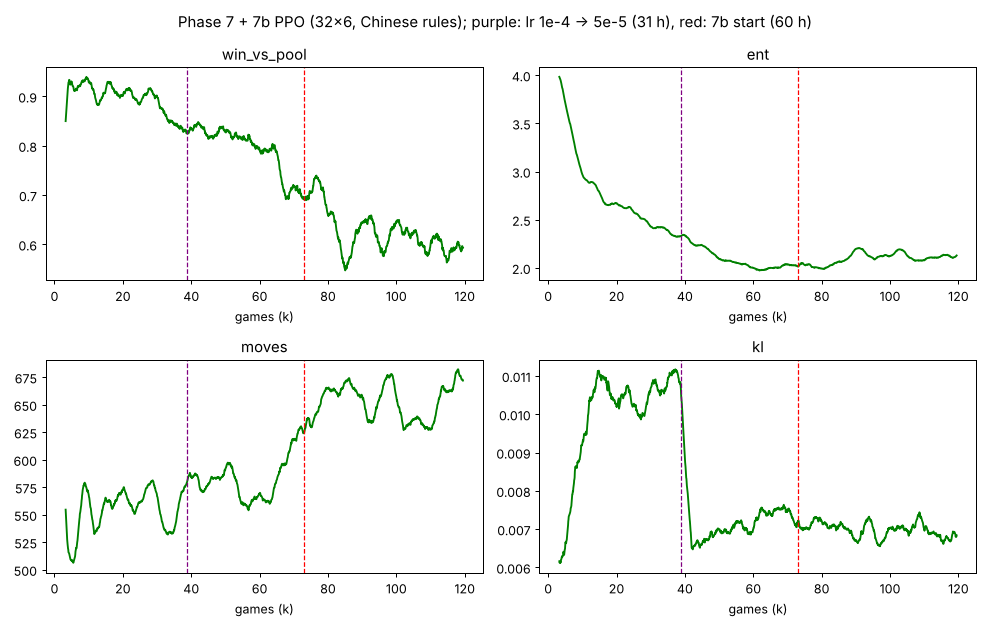

# Phase 7b: phase 7 continued to 100 h

## Setup
- **Continuation of phase 7:** same network (32 channels, 6 blocks, Chinese rules), resumed from the phase 7 checkpoint at 60 h with the same settings: lr 5e-5, 64 games per iteration, minibatch 2048, `--sym`, entropy coefficient 0.01.
- **Budget:** 40 more hours (60 → 100 h), from iteration 1139 to 1867. Games went from 72.9k to **119.5k** (46.6k new games).
- **Files:** `runs/p7b_s0/` holds `history.jsonl` (phase 7 and 7b together), `final.pt` (the last 4 policies) and `full.pt` (policy plus value head).
  - `config.json` is **stale**: it is not rewritten on resume and still shows `hours 40` and `lr 1e-4` from the start of phase 7.
  - `history.jsonl` has 1,806 rows for 1,867 iterations: one row is lost at each resume. Those iterations were trained, but their rows were not saved.
- **Command:** `python -m goevo.ppo --out work/p7b_s0 --rules chinese --channels 32 --blocks 6 --sym --hours 100 --games 64 --lr 5e-5 --minibatch 2048 --bench-every 0 --resume`, in segments of `timeout 6600`.

## Results



Purple line: lr change at 31 h. Red line: start of 7b (60 h).

```
phase 7b PPO (work/p7b_s0): 1867 iterations, 119488 games, 100.00 h. Win rate of the last 4 policies (all pairings x both colours)
vs own hour 24              1.000 ± 0.000  (n=8)
vs own hour 40              0.875 ± 0.117  (n=8)
vs own hour 59              1.000 ± 0.000  (n=8)
vs own hour 70              0.375 ± 0.171  (n=8)
vs own hour 80              0.750 ± 0.153  (n=8)
vs own hour 90              0.875 ± 0.117  (n=8)
vs own hour 96              0.500 ± 0.177  (n=8)
vs own hour 98              0.625 ± 0.171  (n=8)
vs own hour 99              0.625 ± 0.171  (n=8)
vs phase 6b final (36 h)    0.438 ± 0.088  (n=32)
vs phase 7 final (60 h)     0.781 ± 0.073  (n=32)
```

**Checks during training:** one snapshot vs the previous 4 snapshots (n=8), and vs the 6b final's 4 policies (n=8).

| Hour | vs previous 4 | vs 6b final |
|---|---|---|
| h62 | 2/8 | 1/8 |
| h64 | 5/8 | 1/8 |
| h66 | 6/8 | 1/8 |
| h68 | 3/8 | 1/8 |
| h70 | 6/8 | 2/8 |
| h72 | 6/8 | 2/8 |
| h74 | 5/8 | 2/8 |
| h76 | 5/8 | 3/8 |
| h78 | 4/8 | 2/8 |
| h80 | 4/8 | 1/8 |
| h82 | 2/8 | 5/8 |
| h84 | 4/8 | 2/8 |
| h86 | 2/8 | 3/8 |
| h88 | 5/8 | 3/8 |
| h90 | 3/8 | 5/8 |
| h92 | 3/8 | 4/8 |
| h94 | 4/8 | 3/8 |
| h96 | 3/8 | 2/8 |
| h98 | 6/8 | 3/8 |

Play is deterministic (masked argmax), with both colours, so n is small and single rows are noisy.

## Interpretation
- **7b is clearly stronger than phase 7:** the final policies won 25 of 32 games (78%) against the phase 7 final.
- **It is close to phase 6b but still slightly behind:** 14 of 32 (44%) against the 6b final, up from 7 of 32 (22%) for phase 7. The hourly checks against 6b rose from about 1/8 early in 7b to about 3/8 later.
- **Against its own snapshots:** 8 of 8 against hours 24 and 59, 7 of 8 against hours 40 and 90, but only 3 of 8 against hour 70 and 4–5 of 8 against hours 96–99. With n=8 these single rows are noisy.
- **Training curves:** entropy stayed at about 2.0–2.2; win rate against the pool kept drifting down (about 0.7 → 0.6) as the pool filled with stronger snapshots; games grew from about 620 to about 670 moves; KL stayed at about 0.007.
- **A guess, not tested:** the gain over phase 7 fits the idea that phase 7 had seen too few games. At 119.5k games 7b still has fewer than 6b's 175.8k.
