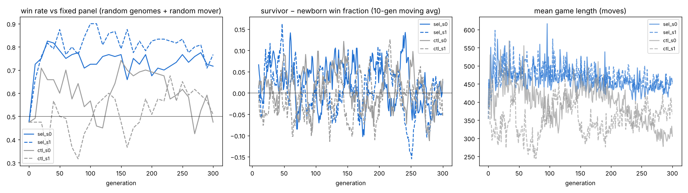
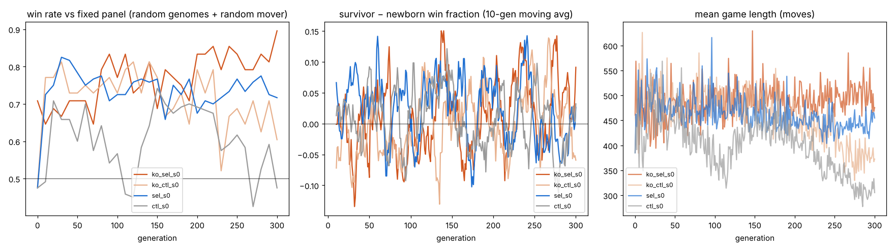
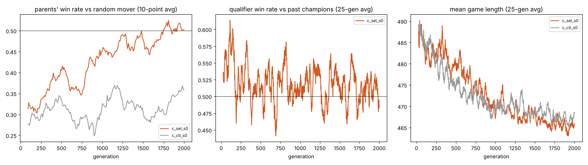
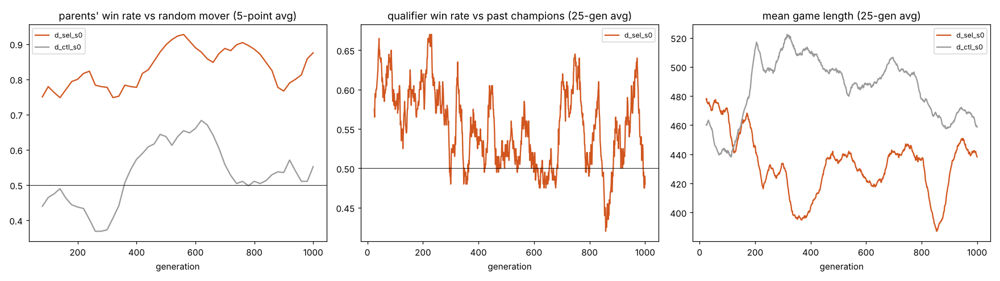

# Phase 2 results: is evolution happening?

**Short answer: yes.** Selection produces clearly stronger players than the no-selection control.
But the improvement levels off after about 100 generations, and the evolved players still lose to a random-move player.

## Setup
* Board: 19×19, komi 7.5, move cap 1083 (3·N²).
* Players: 10-layer MLP, tanh, 128 hidden units, 363,882 parameters.
* Generations: population of 10, each genome plays 5 games, 300 generations.
* Reproduction: mutation only, σ = 0.1 × each layer's init std, no crossover.
* **Selection runs** (`sel_s0`, `sel_s1`): only *winners* (more wins than losses in their 5 games) reproduce.
  Winners survive unchanged, and mutated children of the winners fill the rest of the population.
* **Control runs** (`ctl_s0`, `ctl_s1`): exactly the same, but the "winners" are picked at random (the same number as the real selection would pick).
  Any difference from the selection runs is therefore due to selection.
* Checkpoints every 50 generations (`runs/*/gen*.pt`). Full per-generation logs in `runs/*/history.jsonl`.

## Evidence



### 1. Fixed benchmark
Every 10 generations, each genome plays both colours against 5 fixed random genomes and a uniform-random mover.

| run | gen 0 | mean gens 100–300 | vs random genomes | vs random mover |
|---|---|---|---|---|
| sel_s0 | 0.475 | **0.734** | 0.807 | 0.367 |
| sel_s1 | 0.475 | **0.819** | 0.898 | 0.429 |
| ctl_s0 | 0.475 | 0.602 | 0.670 | 0.260 |
| ctl_s1 | 0.475 | 0.549 | 0.617 | 0.210 |

### 2. Head-to-head
All 10×10 pairings, both colours, 200 games each (`head_to_head.txt`):

| match | win rate of first |
|---|---|
| sel_s0 gen300 vs ctl_s0 gen300 | **0.680** |
| sel_s0 gen300 vs ctl_s1 gen300 | **0.735** |
| sel_s1 gen300 vs ctl_s0 gen300 | **0.830** |
| sel_s1 gen300 vs ctl_s1 gen300 | **0.735** |
| sel_s0 gen300 vs own gen0 | **0.805** |
| sel_s1 gen300 vs own gen0 | **0.780** |
| ctl_s0 gen300 vs own gen0 | 0.605 |
| ctl_s1 gen300 vs own gen0 | 0.540 |
| sel_s0 gen300 vs own gen150 | 0.555 |
| sel_s1 gen300 vs own gen150 | 0.435 |
| sel_s0 gen300 vs sel_s1 gen300 | 0.485 |

With 200 games, one standard error is about ±0.035. The selection-vs-control and selection-vs-gen0 differences are far outside that.

### 3. Behaviour changed
Games between selected players got longer (about 450 moves, against about 350 in the controls).
The players seem to have learned to avoid playing into self-atari or capture, so they keep more stones on the board.

## Caveats and what to do next
* **Plateau.** The real gain happens in the first ~50–100 generations. Generation 300 is not better than generation 150 (0.555 and 0.435).
  This is typical for a population of 10, 5 noisy games per genome and pure relative fitness.
* **Weak survivor advantage.** Last generation's winners beat this generation's newborn children only slightly more often (+0.01 to +0.02, against about 0 in the controls).
  Five games per genome is a very noisy measure of fitness.
* **Still worse than random play.** The evolved players lose to the uniform-random mover (37–43% win rate).
  Better than the controls (21–26%), but they are still very weak Go players.
* **Controls drift above 0.5 against the random-genome panel too.** Possibly because elitism plus mutation favours certain weight scales.
  That's why the controls, not 0.5, are the right baseline.

Ideas for phase 3:
* bigger population or more games per genome (less noisy fitness);
* hall-of-fame / ancestor opponents to avoid cycling;
* include the random mover in the fitness;
* smaller or adaptive σ;
* convolutional or weight-shared input layer;
* save checkpoints in float16 to keep the repo small.

---

# Phase 2b: stronger selection pressure

## What changed (compared with phase 2a)
| | phase 2a | phase 2b |
|---|---|---|
| population | 10 | **32** |
| tournament | 5 round-robin games per genome (25 games) | **knockout bracket**, 1 game per match (31 games) |
| parents | everyone with a winning record (~5 of 10, ~50%) | **best 4 of 32 (12.5%)** |
| fixed opponents in fitness | none | the bracket's top 8 play 2 games vs the random mover + 2 vs a **hall of fame** of past champions; fitness = rounds won + 1.5 × qualifier win rate |
| mutation σ | 0.1 | **0.03** |
| checkpoints | whole population every 50 generations | **only the 4 final parents** |

Runs: `ko_sel_s0` (selection) and `ko_ctl_s0` (control: same, but the 4 parents are picked at random and no qualifier is played).
Both ran for 300 generations: 87 min and 48 min on 2 CPUs each.

## Results
Head-to-head (`phase2b_eval.txt`). Play is deterministic, so every pairing is played once with each colour:

| match | win rate of first | n |
|---|---|---|
| **2b selection vs 2b control** | **0.906 ± 0.05** | 32 |
| **2b selection vs generation 0** | **0.898 ± 0.02** | 256 |
| 2b control vs generation 0 | 0.621 ± 0.03 | 256 |
| 2a selection vs generation 0 | 0.794 ± 0.01 | 1280 |
| **2b selection vs 2a selection (final)** | **0.569 ± 0.04** | 160 |
| 2b selection vs 2a control (final) | 0.775 ± 0.03 | 160 |
| 2b control vs 2a selection (final) | 0.306 ± 0.04 | 160 |

Against the uniform-random mover (a stochastic opponent; 50 games per genome):

| players | win rate |
|---|---|
| generation 0 | 0.105 ± 0.015 |
| 2a control | 0.202 ± 0.013 |
| 2b control | 0.220 ± 0.029 |
| 2a selection | 0.342 ± 0.015 |
| **2b selection** | **0.450 ± 0.035** |



## Interpretation
* **Stronger selection pressure works.** At the same number of generations, the 2b players:
  * beat generation 0 90% of the time (2a: 79%);
  * beat the phase-2a champions 57% of the time;
  * win 45% against the random mover (2a: 34%; generation 0: 10%).
* **No plateau yet.** The benchmark of the 2b selection run is still rising at generation 300, while 2a levelled off after about 100 generations.
  The qualifier win rate stays flat at about 0.52 even though the hall-of-fame opponents keep getting stronger, which also points to steady improvement.
* **The control drifts too.** The 2b control beats generation 0 62% of the time: mutation plus random selection still drifts towards "less suicidal" play.
  The selection-vs-control gap is the real effect.
* **Still not better than random play.** The players are almost at 50% against the random mover, but not above it.
* **The "survivor − newborn" panel doesn't apply to the knockout runs.** One elimination game is too coarse for it. Use the head-to-head numbers instead.

## Next steps
* Keep running the 2b selection run, which is still improving. Continue from `runs/ko_sel_s0/gen0300.pt`.
* A second seed, to confirm the result.
* A larger population and bracket (64 genomes), or a double-elimination bracket.


# Phase 2c: fast engine, pass only when forced, 64 genomes × 2000 generations

Two runs with seed 0:
* `c_sel_s0` uses knockout selection; the qualifier is played against the hall of fame.
* `c_ctl_s0` picks random parents.

Each run took about 1.8 h with 2 workers. Only the final 4 parents (`gen2000.pt`) are committed.



The parents' win rate against the random mover (24 games each, every 10 generations) climbs steadily under selection:
* selection run: 0.31 over the first 100 generations, 0.51 over the last 200;
* control run: 0.28 → 0.35, which is drift only.

The qualifier stays near 0.5. That is expected, because each new champion is measured against recent champions, which are similar in strength.

Final evaluation (`python -m goevo.eval_phase2c`, current rules):

```
win rate of the first set; all pairings x both colours (deterministic play)
 c_sel vs c_ctl  0.750 ± 0.077  (n=32)
 c_sel vs gen0   0.758 ± 0.038  (n=128)
 c_ctl vs gen0   0.570 ± 0.044  (n=128)
 c_sel vs ko_sel 0.625 ± 0.086  (n=32)

win rate vs uniform-random mover (100 games per genome)
 c_sel: 0.495 ± 0.025  (n=400)
 c_ctl: 0.385 ± 0.024  (n=400)
ko_sel: 0.440 ± 0.025  (n=400)
  gen0: 0.281 ± 0.016  (n=800)
```

## Interpretation
* The selection signal is clear and still growing.
  * The selection run's champions are now as good as a random mover (0.50). Generation 0 scores 0.28, and the control run gets no better than 0.39.
  * They beat the phase 2b champions 63% of the time.
* Progress is slow, roughly +0.1 vs the random mover per 1000 generations.
* Ideas for faster progress:
  * longer runs, which resume from `state.pt`;
  * larger σ early on, or several seeds;
  * more games per genome, to reduce noise in the knockout.


# Phase 2d: convolutional network, 32 genomes × 1000 generations

Changes from phase 2c:
* **Network:** 10 3×3 conv layers, 16 channels, tanh; one output per board point plus a pass output from the averaged features.
  * About 22.5k weights, which is 16× fewer than the MLP and independent of board size.
* **Inputs:** 11 planes:
  * own, opponent and empty points, and legal moves;
  * liberty counts of 1, 2 and 3+ for each side;
  * a plane of ones that shows the board edge.
* **Selection:** 32 genomes, knockout bracket. The top 4 play 2 qualifier games each against the hall of fame, and the best 4 reproduce. σ = 0.03.
* **Speed:** about 7 s per generation with 2 workers; each run took about 2 h.



Final evaluation (`python -m goevo.eval_phase2d 1000`):

```
phase 2d, generation 1000. Win rate of the first set; all pairings x both colours
d_sel vs d_ctl        0.938 ± 0.043  (n=32)
d_sel vs gen0         0.867 ± 0.030  (n=128)
d_sel vs c_sel (MLP)  0.812 ± 0.069  (n=32)
d_ctl vs gen0         0.562 ± 0.044  (n=128)

win rate vs uniform-random mover (100 games per genome)
 d_sel: 0.885 ± 0.016  (n=400)
 d_ctl: 0.623 ± 0.024  (n=400)
  gen0: 0.383 ± 0.017  (n=800)
```

## Interpretation
* **The target is reached:**
  * The selection run's champions beat the random mover **88.5 ± 1.6%** of the time. The MLP reached 50% after 2000 generations.
  * They beat the phase 2c MLP champions 81% of the time.
  * They beat the control run 94% of the time.
* **Most of the gain comes early:** the champions reach about 0.8 vs the random mover within 100 generations. After about 500 generations they level off around 0.85–0.9.
* **Selection matters, not just the architecture:** the control run, with the same architecture, drifts to 0.62 vs the random mover, and generation 0 scores 0.38.
* **Next options:**
  * a stronger yardstick than the random mover, for example the MLP champions, or a one-ply greedy player that captures whenever it can;
  * more channels;
  * longer runs, which resume from `work/`.
